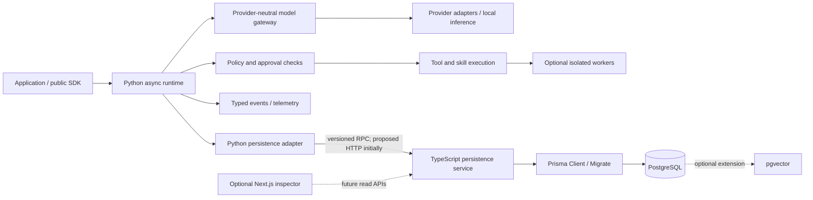
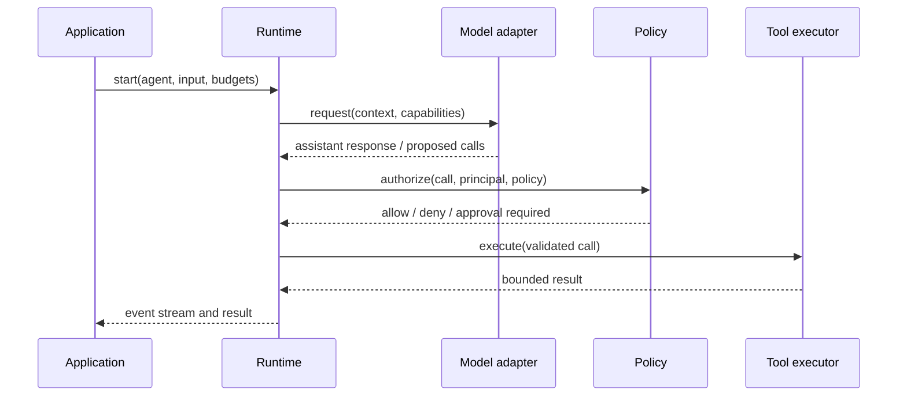

# YANTRA (यन्त्र)

**Build Agents. Connect Models. Own the Execution.**

YANTRA is a model-agnostic AI agent harness and orchestration framework intended for open-source development. Its architecture aims to give developers explicit control over agent execution, tools, skills, state, persistence, security policy, and observability without binding the framework to one model vendor or application.

> **Status:** YANTRA-001 core contracts and the YANTRA-002 model gateway have local test coverage. YANTRA-003 bounded agent execution is engineering-accepted on its feature branch, but remains experimental and is not included in the unreleased `0.2.0` package. YANTRA-004-V01–V05 are accepted for engineering completion on `feat/yantra-004-secure-tools`, not released. V05 locally verifies 229 tests, Ruff, Pyright, lock consistency, and all offline examples on macOS 26.5.1/Python 3.12.15. RR-001 engineering verification passes, but public release readiness is NO-GO: the available `0.2.0` artifacts are stale relative to this checkout, and Windows, Python 3.13/3.14, hosted CI, and a fresh package build remain unverified. Subprocess execution is not an OS sandbox, provides no process-tree guarantee, and has no OS resource quotas. Approvals are not durable or exactly-once. Usage/cost limits are not hard spending ceilings. See the [RR-001 release-readiness evidence](docs/development/yantra-release-readiness-rr001.md), [YANTRA-004 engineering closure](docs/development/yantra-004-engineering-closure.md), [offline agent quickstart](docs/guides/agent-quickstart.md), [secure tool runtime](docs/security/secure-tool-runtime.md), [secure tool platform validation](docs/development/secure-tool-platform-validation.md), [provider verification matrix](docs/features/provider-verification.md), [agent execution engine](docs/architecture/agent-execution-engine.md), [release notes](docs/releases/v0.2.0-release-notes.md), and [release audit](docs/releases/v0.2.0-release-audit.md).

## Why a harness?

An agent harness is the infrastructure around a model-driven loop: it assembles context, requests model output, validates and authorizes actions, executes tools, records state transitions, and decides whether to continue, suspend, or finish. Models provide inference; the harness owns execution policy and effects.

Applications commonly rebuild this boundary, leaving inconsistent provider behavior, hidden tool permissions, weak recovery, and opaque execution history. YANTRA's engineering philosophy is explicit contracts, asynchronous typed interfaces, replaceable components, least privilege, durable state where needed, and lightweight local use without mandatory infrastructure. The core must not delegate orchestration to LangChain, CrewAI, AutoGen, or LangGraph.

## Intended capabilities

- Provider-neutral model gateway with capability negotiation, streaming, normalized errors, and accounting.
- Async agent runtime, typed tool registry, policy checks, sessions, events, checkpoints, and cancellation.
- Versioned skills with manifests, validation, permission declarations, discovery, and controlled execution.
- Optional PostgreSQL durability through a TypeScript Prisma persistence service; optional pgvector and Redis.
- Workflow and bounded multi-agent orchestration, human approval, integrations, evaluation, and observability.
- SDK and CLI first; optional independent visual inspector later.

For local gateway checks, see the [YANTRA-002 smoke-test guide](docs/development/smoke-testing.md). The smoke CLI is not an agent runner.

Skills, PostgreSQL persistence, web/browser, workflows, and distributed capabilities remain design targets. The model gateway supports opt-in deterministic routing; adaptive routing remains experimental. See the [feature matrix](docs/project/feature-matrix.md) and [roadmap](ROADMAP.md).

## Architecture at a glance



The Python runtime never imports Prisma or accesses its generated client. Transient loop state stays in process unless a durability requirement makes persistence necessary. Cross-service calls are reserved for durable operations, not every model/tool transition. See [system design](docs/architecture/system-design.md) and [persistence architecture](docs/architecture/persistence-architecture.md).

## Execution model

The proposed kernel creates a run within a session, assembles bounded context, sends a capability-aware request to a provider adapter, validates the response, and authorizes each proposed tool call independently of model output. Tool results become typed observations and events. A run ends in a terminal state or suspends at an approval, budget, or recovery boundary. Durable checkpoints support recovery but do not promise exactly-once external effects.



## Proposed technology

| Area | Proposed choice |
|---|---|
| Implemented core | Python 3.12+, asyncio, Pydantic v2, typed `Protocol` interfaces |
| Python tooling | uv, hatchling, Ruff, Pyright, pytest, pytest-asyncio, Hypothesis |
| Durable persistence | PostgreSQL, TypeScript service, Prisma ORM and Prisma Migrate |
| Local persistence | In-memory adapter; no database required for simple local execution |
| Optional infrastructure | pgvector for selected retrieval use cases; Redis only when coordination/cache needs justify it |
| Web capabilities | HTTPX, Beautiful Soup, Playwright |
| Observability | OpenTelemetry, structlog, structured JSON logs; optional Prometheus/Grafana |
| Developer tools | Standard-library argparse smoke runner, MkDocs Material, Mermaid |
| Infrastructure | Docker, GitHub Actions, PostgreSQL; optional Redis/container workers |
| Future inspector | Next.js, TypeScript, Tailwind CSS; never required by SDK |

Dependencies are defined in `pyproject.toml`; HTTPX supports the model gateway and keyring is an optional credentials extra. YANTRA is licensed under Apache-2.0.

## Model and capability architecture

Adapters normalize transport, authentication, streaming chunks, usage, and provider errors into versioned YANTRA contracts. The current gateway implements OpenAI, Anthropic, Gemini, DeepSeek, Ollama, OpenRouter, OpenCode Zen/Go, and a configurable OpenAI Chat Completions-compatible subset. Capabilities are negotiated per model/deployment; unknown support stays unknown. Mocked HTTP tests do not establish live provider compatibility. See the [provider verification matrix](docs/features/provider-verification.md), [model gateway](docs/architecture/model-gateway.md), and [provider contract](docs/specifications/model-provider-contract.md).

## Tools and skills

Tools are individual executable capabilities with schemas, permissions, side-effect classification, limits, and audit events. Skills are immutable-version packages of instructions, resources, metadata, dependencies, and declared capabilities; they are not trusted executable code. The model can suggest a tool call but cannot authorize itself. Imported or generated skills remain untrusted pending validation and approval. See the [tool contract](docs/specifications/tool-contract.md) and [skill ecosystem](docs/architecture/skill-engine.md).

## Persistence and security

The proposed TypeScript service owns database access and Prisma migrations. The Python adapter speaks a versioned RPC contract; initial transport recommendation is HTTP/JSON over authenticated TLS because it is inspectable and operationally straightforward. gRPC and in-process alternatives are evaluated in the [persistence service design](docs/database/persistence-service.md). No raw credentials belong in database tables. Tool, browser, plugin, and sandbox boundaries require least privilege; Docker alone is not considered a complete security boundary. See [threat model](docs/security/threat-model.md).

## Core contracts quickstart

Install the checkout and development tools with `uv sync --all-groups`. This example exercises the mock provider only; it does not run an agent loop or make network requests.

```python
import asyncio

from yantra.core.messages import Message, MessageRole, TextContent
from yantra.providers import ModelRequest, MockProvider

request = ModelRequest(
    model_id="mock-small",
    messages=(Message(role=MessageRole.USER, content=(TextContent(text="Hello"),)),),
)
provider = MockProvider([MockProvider.text_response(request, "Hello from YANTRA")])
response = asyncio.run(provider.complete(request))
print(response.message.content[0].text)
```

See [development setup](docs/development/setup.md) and the [core API reference](docs/specifications/core-runtime-api.md). Tool registry examples and API limitations are described there.

## Repository and documentation

Python source is under `src/yantra`; unit tests are under `tests`; packaging/tooling are in `pyproject.toml`; cross-platform CI is in `.github/workflows/ci.yml`. Use [documentation index](docs/index.md) to navigate; begin with [core API reference](docs/specifications/core-runtime-api.md), [runtime kernel](docs/architecture/runtime-kernel.md), [security](docs/security/threat-model.md), and [acceptance criteria](docs/roadmap/acceptance-criteria.md).

## Roadmap and contribution

Milestones proceed from packaging/contracts/runtime to durability, skills and secure tools, orchestration, and developer platform. Each milestone has gates; checklist completion alone does not establish production readiness. See [ROADMAP.md](ROADMAP.md), [contributing](CONTRIBUTING.md), [governance](GOVERNANCE.md), and [security reporting](SECURITY.md). NIRMAAN is a separate downstream application and must consume a versioned public YANTRA SDK; see [integration boundary](docs/integrations/nirmaan.md).

## License

Copyright 2026 Rishit Singh.

YANTRA is licensed under the Apache License, Version 2.0.

See the [LICENSE](LICENSE) file for the complete license terms.
