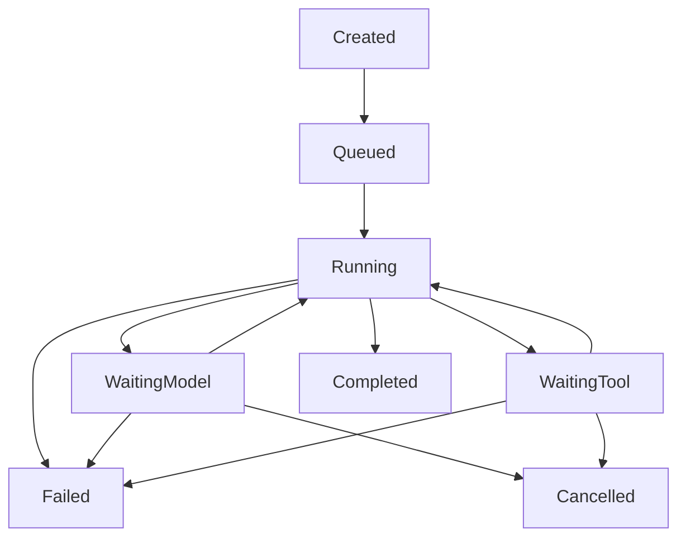

# Agent Execution Engine (YANTRA-003-V01)

**Status: Implemented and locally verified on the feature branch.** This is an
experimental post-`0.2.0` runtime milestone; it is not part of the `0.2.0`
release candidate.

`yantra.runtime.AgentExecutionEngine` composes the existing `ModelGateway` with
the existing provider-neutral messages and `ToolRegistry`. Each model response
is appended to the in-memory conversation. A final assistant message completes
the run; tool proposals are validated and executed sequentially, and each
`ToolResult` is appended as a tool message before the next model request.



## API

```python
import asyncio

from yantra.core.contracts import ProviderCapabilities
from yantra.core.messages import Message, MessageRole, TextContent
from yantra.providers import ModelGateway, ModelResponse, ProviderRegistry
from yantra.providers.base import FinishReason
from yantra.runtime import AgentExecutionEngine, AgentRunConfig
from yantra.tools import ToolRegistry

class OfflineProvider:
    provider_id = "mock"
    capabilities = ProviderCapabilities(token_usage=True)

    async def complete(self, request):
        return ModelResponse(
            request_id=request.request_id,
            provider_id=self.provider_id,
            model_id=request.model_id,
            message=Message(
                role=MessageRole.ASSISTANT,
                content=(TextContent(text="Hello from YANTRA"),),
            ),
            finish_reason=FinishReason.STOP,
        )

providers = ProviderRegistry()
providers.register(OfflineProvider(), is_local=True)
engine = AgentExecutionEngine(ModelGateway(providers), ToolRegistry())

config = AgentRunConfig(
    model="mock/model",
    messages=(
        Message(role=MessageRole.USER, content=(TextContent(text="Hello"),)),
    ),
    max_steps=4,
    timeout_seconds=30,
)
result = asyncio.run(engine.run(config))
assert result.output == "Hello from YANTRA"
```

The engine accepts a `ModelGateway` and a `ToolRegistry` (or `ToolExecutor`).
`AgentRunConfig` validates the model, initial messages, finite step/tool/time
limits, and optional token/cost budgets. `AgentRunResult` exposes the terminal
state, termination reason, final assistant message, ordered steps/tool results,
known usage/cost, and sanitized trace metadata.

## Safety and failures

Registration is explicit and does not itself grant permission. The executor
only resolves exact names in the supplied registry, validates arguments with
the registered Pydantic model, validates declared outputs, and supports
async/sync handlers. Unknown tools, invalid arguments, handler exceptions, and
tool timeouts become structured error observations for the next model request.
No shell, Python evaluation, browser, filesystem, network, or MCP capability is
provided by this milestone.

Tool calls run sequentially in response order. Call IDs must be unique across a
run; duplicate IDs fail the run before any call in that response is executed.
This deterministic policy avoids accidental duplicate external effects while a
future secure tool runtime is designed.

The total wall-clock deadline covers gateway and tool operations. An explicit
`CancellationToken.cancel()` cancels in-flight async work and returns a
`CANCELLED` result. Normal asyncio task cancellation remains normal
`CancelledError` propagation. Step and tool limits always bound progress.

Provider-reported usage is summed without synthesizing missing values. If any
model response omits usage, `usage_complete` is false and the result does not
claim a complete aggregate. Monetary limits are enforced only when the gateway
returns a reliable reported or estimated cost; otherwise `total_cost_usd` is
unknown and no cost enforcement is claimed.

Trace entries contain state/event metadata, step number, tool name/call ID,
outcome, and known usage. They intentionally exclude tool arguments, full
conversation payloads, credentials, authorization headers, and provider
reasoning metadata.
