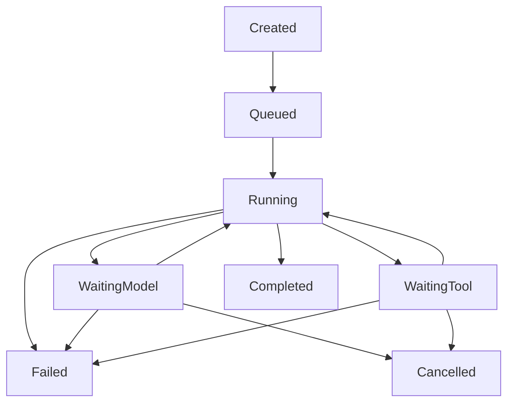

# Agent Execution Engine (YANTRA-003-V02)

**Status: Implemented and locally verified on the feature branch.** V02 hardens
the V01 runtime loop and its failure, cancellation, budget, and trace behavior.
This is an experimental post-`0.2.0` runtime milestone; it is not part of the
`0.2.0` release candidate.

`yantra.runtime.AgentExecutionEngine` composes the existing `ModelGateway` with
the existing provider-neutral messages and `ToolRegistry`. Each model response
is appended to the in-memory conversation. A final assistant message completes
the run; tool proposals are validated and executed sequentially, and each
`ToolResult` is appended as a tool message before the next model request.



## API

```python
import asyncio

from yantra.core.contracts import ProviderCapabilities
from yantra.core.messages import Message, MessageRole, TextContent
from yantra.providers import ModelGateway, ModelResponse, ProviderRegistry
from yantra.providers.base import FinishReason
from yantra.runtime import AgentExecutionEngine, AgentRunConfig
from yantra.tools import ToolRegistry

class OfflineProvider:
    provider_id = "mock"
    capabilities = ProviderCapabilities(token_usage=True)

    async def complete(self, request):
        return ModelResponse(
            request_id=request.request_id,
            provider_id=self.provider_id,
            model_id=request.model_id,
            message=Message(
                role=MessageRole.ASSISTANT,
                content=(TextContent(text="Hello from YANTRA"),),
            ),
            finish_reason=FinishReason.STOP,
        )

providers = ProviderRegistry()
providers.register(OfflineProvider(), is_local=True)
engine = AgentExecutionEngine(ModelGateway(providers), ToolRegistry())

config = AgentRunConfig(
    model="mock/model",
    messages=(
        Message(role=MessageRole.USER, content=(TextContent(text="Hello"),)),
    ),
    max_steps=4,
    timeout_seconds=30,
)
result = asyncio.run(engine.run(config))
assert result.output == "Hello from YANTRA"
```

The engine accepts a `ModelGateway` and a `ToolRegistry` (or `ToolExecutor`).
`AgentRunConfig` validates the model, initial messages, finite step/tool/time
limits, unique optional tool allowlist, and optional token/cost budgets.
`AgentRunResult` exposes the terminal state, termination reason, final
assistant message, ordered steps/tool results, known usage/cost, and sanitized
trace metadata. Runs keep their message history, counters, and trace local, so
one engine can serve concurrent independent runs when its registry is not
mutated during execution.

## Safety and failures

Registration is explicit and does not itself grant permission. The executor
only resolves exact names in the supplied registry, validates arguments with
the registered Pydantic model, validates declared outputs, and supports
async/sync handlers. Unknown tools, invalid arguments, handler exceptions, and
tool timeouts become structured error observations for the next model request.
No shell, Python evaluation, browser, filesystem, network, or MCP capability is
provided by this milestone.

Tool calls run sequentially in response order. Assistant proposals remain in
the history, and each result is added as a tool message with its original call
ID before the next model request. The OpenAI-compatible message conversion is
covered by offline protocol tests. Call IDs must be unique across a run;
duplicate IDs fail before any call in that response is executed. Repeating a
tool name is permitted with a fresh call ID. A configured `tool_names` list
limits both advertised and executable tools; the default empty tuple keeps all
registry tools enabled. A proposal outside a non-empty allowlist becomes a
structured `tool_not_permitted` observation. A batch that exceeds the remaining
tool-call budget is rejected in full, without partial execution.

`max_steps` counts model requests: a final text response on the last allowed
step completes normally, but a tool proposal on that step is not executed and
the run ends with `max_steps`. Provider errors are terminal and sanitized,
while unknown/disabled tools, invalid arguments, handler exceptions, and tool
timeouts remain structured observations for the model. Completed steps and
tool observations are retained when a later provider failure or run timeout
occurs.

The monotonic total wall-clock deadline covers gateway and tool waits. Timeout
returns a `FAILED` result with partial progress and a terminal trace event. An
explicit `CancellationToken.cancel()` cancels and awaits in-flight gateway/tool
tasks and returns a `CANCELLED` result. Normal asyncio task cancellation
remains normal `CancelledError` propagation. Async handlers are cancellable;
sync handlers run in a worker thread and Python cannot forcibly stop that
thread, so timeout/cancellation stops waiting but may not stop its underlying
work. Step and tool limits also bound progress.

Provider-reported usage is summed without synthesizing missing values. If any
model response omits usage, `usage_complete` is false and the result does not
claim a complete aggregate. When a token budget is configured, missing usage
fails closed before further actions. Monetary limits use gateway-reported cost
or its estimate; if cost is unknown while a cost budget is configured, the run
fails closed rather than claiming enforcement. Without a configured cost
budget, unknown cost remains unknown.

Trace entries contain state/event metadata, step number, tool name/call ID,
outcome, and known usage. They intentionally exclude tool arguments, full
conversation payloads, credentials, authorization headers, and provider
reasoning metadata.

## Verification boundary

V02 is locally tested with mocked providers and tools. Tests cover multiple
model/tool turns, ordered call/result wire messages, repeated tool names,
budget boundaries, provider failures, timeout and cancellation cleanup,
partial-progress retention, trace redaction, and concurrent run isolation.
This does not establish live provider compatibility, Windows behavior, hosted
CI results, hard termination of synchronous work, durable recovery, or
exactly-once external effects. See the [core runtime API](../specifications/core-runtime-api.md)
for the broader API and limitations.
