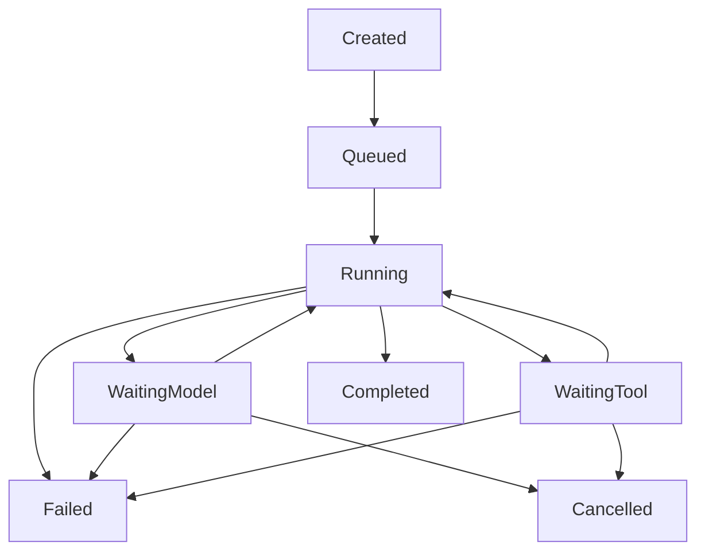

# Agent Execution Engine (YANTRA-003)

**Status: Engineering-accepted on the feature branch; experimental and unreleased.**
The YANTRA-003 runtime has local verification evidence, but is not included in
the unreleased `0.2.0` package. Its available tool authorization is an explicit
per-run name allowlist; `permission_scopes` remain descriptive, and no general
scope/policy engine is implemented. Usage and cost accounting are best-effort,
not a hard spending ceiling. See the YANTRA-003 engineering closure in
[`milestones.md`](../roadmap/milestones.md).

`yantra.runtime.AgentExecutionEngine` composes the existing `ModelGateway` with
the existing provider-neutral messages and `ToolRegistry`. Each model response
is appended to the in-memory conversation. A final assistant message completes
the run; tool proposals are validated and executed sequentially, and each
`ToolResult` is appended as a tool message before the next model request.



## API

```python
import asyncio

from yantra.core.contracts import ProviderCapabilities
from yantra.core.messages import Message, MessageRole, TextContent
from yantra.providers import ModelGateway, ModelResponse, ProviderRegistry
from yantra.providers.base import FinishReason
from yantra.runtime import AgentExecutionEngine, AgentRunConfig
from yantra.tools import ToolRegistry

class OfflineProvider:
    provider_id = "mock"
    capabilities = ProviderCapabilities(token_usage=True)

    async def complete(self, request):
        return ModelResponse(
            request_id=request.request_id,
            provider_id=self.provider_id,
            model_id=request.model_id,
            message=Message(
                role=MessageRole.ASSISTANT,
                content=(TextContent(text="Hello from YANTRA"),),
            ),
            finish_reason=FinishReason.STOP,
        )

providers = ProviderRegistry()
providers.register(OfflineProvider(), is_local=True)
engine = AgentExecutionEngine(ModelGateway(providers), ToolRegistry())

config = AgentRunConfig(
    model="mock/model",
    messages=(
        Message(role=MessageRole.USER, content=(TextContent(text="Hello"),)),
    ),
    max_steps=4,
    timeout_seconds=30,
)
result = asyncio.run(engine.run(config))
assert result.output == "Hello from YANTRA"
```

The engine accepts a `ModelGateway` and a `ToolRegistry` (or `ToolExecutor`).
`AgentRunConfig` validates the model, initial messages, finite step/tool/time
limits, unique optional tool allowlist, and optional token/cost budgets.
`AgentRunResult` exposes the terminal state, termination reason, final
assistant message, ordered steps/tool results, known usage/cost, and sanitized
trace metadata. The public `format_run_result(result)` helper renders a
payload-minimal human-readable summary and trace without dumping messages,
tool arguments, tool payloads, exception text, or reasoning. Runs keep their
message history, counters, and trace local, so one engine can serve concurrent
independent runs when its registry is not mutated during execution.

## Safety and failures

Registration is explicit and does not itself grant permission. The executor
only resolves exact names in the supplied registry, validates arguments with
the registered Pydantic model, validates declared outputs, and supports
async/sync handlers. Unknown tools, invalid arguments, handler exceptions, and
tool timeouts become structured error observations for the next model request.
No shell, Python evaluation, browser, filesystem, network, or MCP capability is
provided by this milestone.

Tool calls run sequentially in response order. Assistant proposals remain in
the history, and each result is added as a tool message with its original call
ID before the next model request. The OpenAI-compatible message conversion is
covered by offline protocol tests. Call IDs must be unique across a run;
duplicate IDs fail before any call in that response is executed. Repeating a
tool name is permitted with a fresh call ID. A configured `tool_names` list
limits both advertised and executable tools; an empty tuple authorizes no
tools. Registration does not authorize execution, and execution independently
checks each model proposal even when its schema was not advertised. Unregistered
names in the allowlist do not grant access and are simply ineffective (only
registered names are advertised). A proposal outside the allowlist becomes a
structured `tool_not_permitted` observation. `permission_scopes` remains
descriptive metadata: this milestone has no scope evaluator, and the field
itself provides no execution enforcement. A batch that exceeds the remaining
tool-call budget is rejected in full, without partial execution.

Compatibility note: the default empty allowlist previously exposed all
registered tools. It now exposes and authorizes none; callers must name each
tool they intend a run to use.

`max_steps` counts model requests: a final text response on the last allowed
step completes normally, but a tool proposal on that step is not executed and
the run ends with `max_steps`. Provider errors are terminal and sanitized,
while unknown/disabled tools, invalid arguments, handler exceptions, and tool
timeouts remain structured observations for the model. Completed steps and
tool observations are retained when a later provider failure or run timeout
occurs.

The monotonic total wall-clock deadline covers gateway and tool waits. Timeout
returns a `FAILED` result with partial progress and a terminal trace event. An
explicit `CancellationToken.cancel()` cancels and awaits in-flight gateway/tool
tasks and returns a `CANCELLED` result. Normal asyncio task cancellation
remains normal `CancelledError` propagation. Async handlers are cancellable;
sync handlers run in a worker thread and Python cannot forcibly stop that
thread, so timeout/cancellation stops waiting but may not stop its underlying
work. Step and tool limits also bound progress.

Budget semantics have separate boundaries. Before a model request, the engine
stops if known cumulative token usage has exhausted the token budget and passes
the remaining token budget as `GenerationSettings.max_output_tokens`. Adapters
map this to their provider-specific output limit where supported. This is an
output cap, not a cap on total input-plus-output usage: input size is not
tokenized by the runtime, provider behavior can differ, and one response can
still exceed the configured total. Actual usage is accounted only after the
response. Missing usage with a configured token budget fails closed before any
subsequent tool or model work, without inventing values.

Cost budgets are also post-response accounting guards. A non-`None`
provider-reported cost takes precedence over the gateway estimate, including a
reported `Decimal("0")`; the estimate is used only when reported cost is
`None`. If both are unavailable, cost remains unknown. Cumulative costs are
added as `Decimal` values. Gateway routing policy may independently preflight
a request when its configured pricing and token bounds are available; the
agent runtime does not create a second pricing engine, estimate prompt tokens,
or guarantee a per-run monetary ceiling. A known response cost at or above
the configured budget prevents further work;
unknown cost with a configured cost budget fails closed after that response.
Consequently, a single admitted request may incur more than the per-run budget
before the runtime can observe and stop it. `cost_budget_enforced` indicates
that known cost was checked to stop further execution, not that billing was
strictly capped. Without a configured cost budget, unknown cost remains
unknown.

Human-readable diagnostics intentionally omit model-supplied tool names and
call IDs, using local `tool[n]` indices to retain tool-result order and status.
Recognized structured tool error categories (`tool_not_permitted`,
`tool_not_found`, `invalid_arguments`, `tool_timeout`, `invalid_output`, and
`tool_exception`) remain visible; missing or unrecognized categories, raw
result payloads, and exception messages are omitted. This is a sanitized
summary, not a raw execution dump. Structured `tool_results` and trace records
retain identifiers needed for correlation.

Structured trace entries contain state/event metadata, step number, tool
name/call ID, outcome, and known usage. The human-readable formatter omits
model-supplied names and IDs. Trace entries intentionally exclude tool
arguments, full conversation payloads, credentials, authorization headers,
and provider reasoning metadata.

## Verification boundary

V02 is locally tested with mocked providers and tools. Tests cover multiple
model/tool turns, ordered call/result wire messages, repeated tool names,
budget boundaries, provider failures, timeout and cancellation cleanup,
partial-progress retention, trace redaction, and concurrent run isolation.
This does not establish live provider compatibility, Windows behavior, hosted
CI results, hard termination of synchronous work, durable recovery, or
exactly-once external effects. See the [core runtime API](../specifications/core-runtime-api.md)
for the broader API and limitations, and the [agent runtime quickstart](../guides/agent-quickstart.md)
for an executable offline demonstration.
