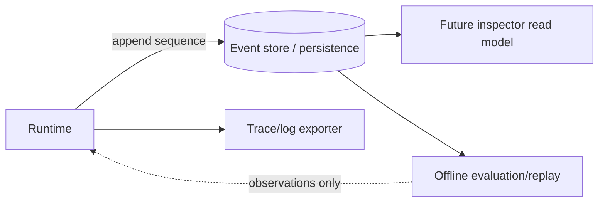

# Event-Driven Design

Events are immutable, versioned observations used for diagnosis, audit, metrics, and future inspection. They are not commands and must not cause side effects when replayed. Event types include run/task state transitions, model request/response metadata, tool authorization/execution lifecycle, approval lifecycle, checkpoint, budget exhaustion, recovery, and workflow edges.

Envelope fields: schema version, event ID, tenant/owner scope where applicable, session/run/task IDs, per-run sequence, type, occurred/recorded timestamps, producer, correlation/causation IDs, payload, and redaction classification. Payload schemas are typed; large content is externalized or omitted according to retention policy. Consumers tolerate unknown optional fields and reject unsupported major versions.

Ordering is guaranteed only within a run sequence, not globally. Delivery to telemetry may be at-least-once or lossy depending on exporter; durable event append has separate semantics. Redaction occurs before export and persistence. Replay reconstructs what was observed and can compare proposed decisions, but never replays external calls by default.
