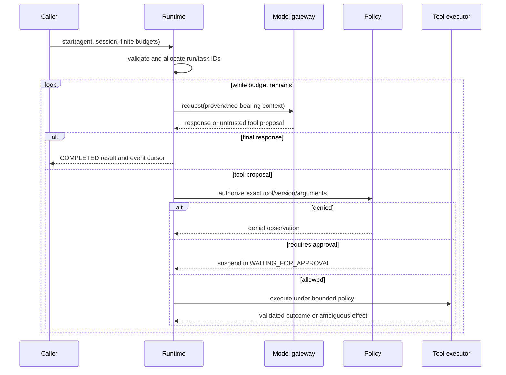

# Execution Lifecycle

1. Validate caller identity, agent-definition version, configuration, request schema, and finite budgets.
2. Allocate session/run/task IDs and emit creation event; persist according to selected adapter.
3. Queue and acquire an execution lease if distributed mode is enabled.
4. Assemble context with source provenance, trust labels, and token budget.
5. Call provider adapter under deadline; normalize response and usage.
6. Validate response. Final output completes; tool proposals pass schema validation and independent policy, with approval suspension when required.
7. Execute authorized calls under limits; record outcomes/events and feed bounded observations into context.
8. Terminate on completion, cancellation, failure, approval, suspension, or exhausted budget.
9. On recovery, reconcile persisted version/lease and ambiguous external effects before any retry.

See [runtime kernel](runtime-kernel.md), [state machine](state-machine.md), [cancellation](../reliability/cancellation.md), and [crash recovery](../reliability/crash-recovery.md).
