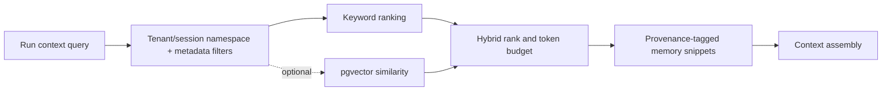

# Memory Engine

The memory engine separates conversation history (interaction record), working memory (run-local scratch), persistent memory (cross-run retained facts), and semantic retrieval (optional similarity index). Memory writes are explicit policy-governed operations with provenance, namespace, sensitivity, TTL/retention, and deletion path. Retrieval returns source IDs and relevance evidence; model-generated summaries are not authoritative facts.

PostgreSQL stores metadata and content subject to privacy/retention; pgvector is optional and can be omitted without loss of core execution. See [context engine](context-engine.md), [memory storage](../database/memory-storage.md), and [feature policy](../features/memory.md).
