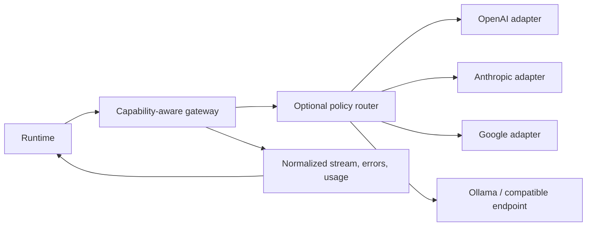

# Model Gateway

The gateway presents a stable request/response/stream contract while adapters translate provider-specific protocols. It must negotiate capabilities for the selected model/deployment and preserve provider identity and request IDs.

Adapter responsibilities: auth reference resolution, timeout/cancellation, streaming chunk normalization, capability declaration, schema validation, provider error classification, usage passthrough, and rate-limit metadata. Tool authorization remains in runtime. Capability discovery may be static, provider queried, or operator-configured; provenance and freshness are recorded. Tool calling, JSON/structured outputs, streaming, vision, and usage details vary. Unsupported requested capabilities produce a typed unsupported-capability error or an explicit caller-approved fallback. Silent downgrade is prohibited.

YANTRA-002 provides a Python `ModelGateway`, explicit provider registry, bounded model catalog, provider adapters (OpenAI, Anthropic, Gemini, DeepSeek, Ollama, OpenRouter, OpenCode Zen/Go, and a configurable OpenAI Chat Completions-compatible subset), and normalized streaming events. RR-004's provider tests use mocked transports; narrow user-reported OpenCode Go evidence and capability limitations are recorded in the [provider verification matrix](../features/provider-verification.md). The configured hosted CI matrix passed on Ubuntu/macOS/Windows and Python 3.12–3.14 in RR-003. Live provider/model/account compatibility remains distinct and mostly unknown; mocked tests and CI do not establish it.

Retries apply only when failure classification and request semantics permit. A request that may have been accepted by the provider is ambiguous; duplicate inference can incur cost and differs from side-effect duplication. Fallback is explicit, records route decision, and must preserve required capabilities and data residency constraints. API keys are never logged or persisted. Cost is an estimate from versioned pricing metadata and reported usage, never a fabricated fact. See [provider contract](../specifications/model-provider-contract.md) and [routing](../features/model-routing.md).
