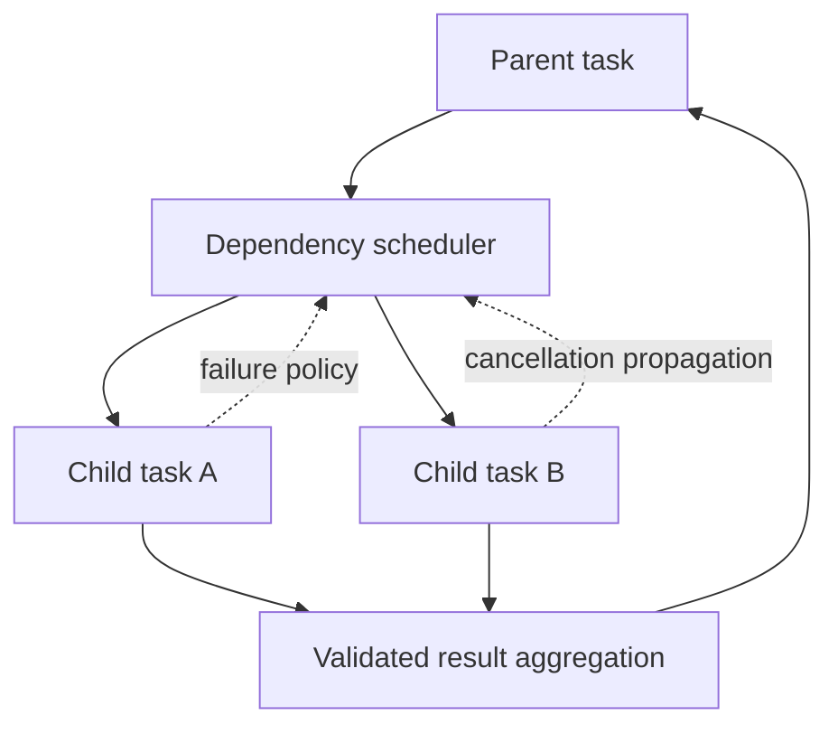

# Orchestration Engine

Orchestration supports deterministic workflow nodes and bounded agent tasks. A scheduler tracks dependencies and resource allocations; a parent may delegate only within configured depth, concurrency, task, token, and deadline budgets. Communication is structured task input/output or explicit messages, not unrestricted shared mutable state.

Cycles are rejected in static workflow graphs. Dynamic delegation uses a depth limit and task budget. Tasks acquire resources in a stable order or use leases with deadlines; no worker waits indefinitely while holding a scarce resource. Failure policy is explicit (fail-fast, collect, compensate, or human intervention). See [multi-agent](../features/multi-agent.md) and [workflow schema](../specifications/workflow-schema.md).
