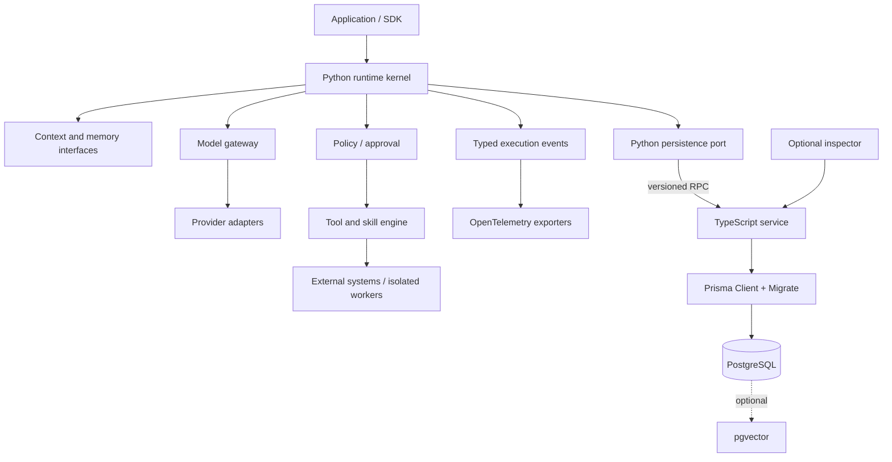

# Architecture Overview

YANTRA is designed as a Python async SDK/runtime surrounded by replaceable adapters. A TypeScript persistence service is the exclusive owner of PostgreSQL and Prisma. The core can run with in-memory state; durable deployment adds the service and PostgreSQL. Optional browser, sandbox, vector, Redis, workers, and inspector components are outside the minimum local runtime.

Trust boundaries are detailed in the [threat model](../security/threat-model.md). The runtime is authoritative for policy and run state; model output, skills, plugins, tool inputs, browser content, and RPC payloads are untrusted until validated.
