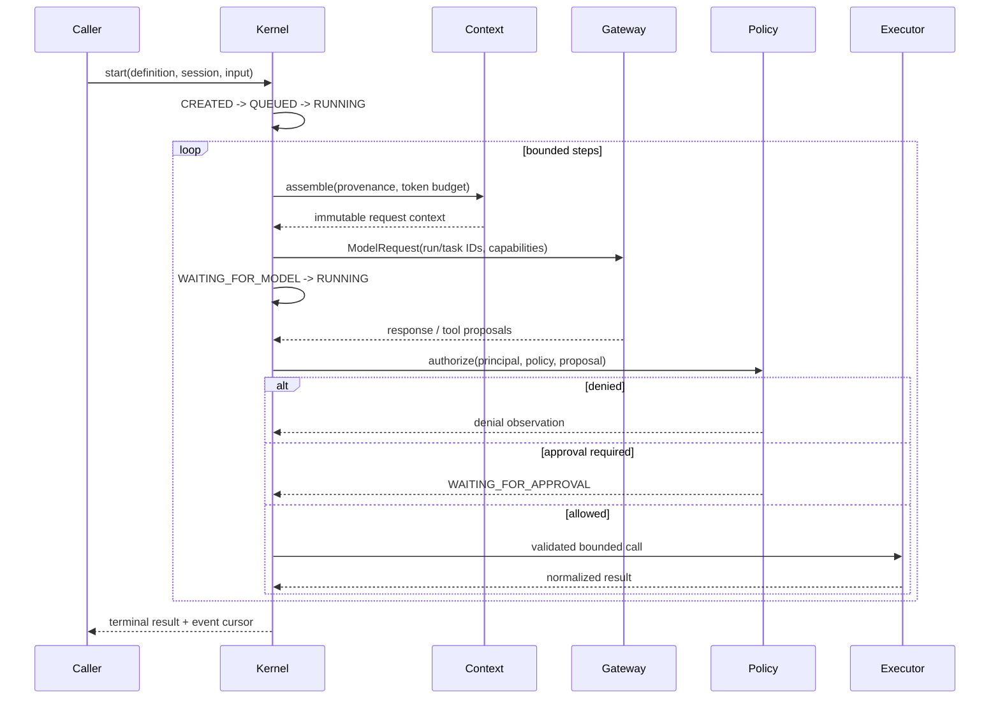

# Runtime Kernel

**Status: Proposed.** This is the authoritative design for the Python execution kernel.

## Objects and identity

- `AgentDefinition`: stable agent ID, definition version, instructions reference, model preference, tool/skill references, policy reference, and declared budgets. It is immutable for a run; updates create a new version.
- `SessionId`: opaque globally unique identifier grouping conversational history. A session can contain many runs and is scoped to an owner/tenant where applicable.
- `RunId`: opaque unique identifier for one invocation and its state machine. It is never reused, including retries.
- `TaskId`: identifier for one root or delegated workflow task; parent/child edges are explicit and bounded.
- `InvocationId` and `ToolExecutionId`: unique IDs for individual external attempts. An idempotency key is separate and only meaningful to a tool that honors it.

Identifiers are opaque (UUIDv7 or UUID recommended, final choice unresolved), validated at boundaries, and never treated as authorization. Tenant/owner identity is supplied by authenticated application context, never inferred from model content.

## Lifecycle

The runtime validates definition and configuration, creates a run in CREATED, validates budgets, then queues/schedules it. Each loop iteration assembles context from trusted instructions and explicitly selected history/memory/skills, computes remaining budgets, and sends a normalized `ModelRequest`. Responses are validated. A final response completes; a tool proposal enters independent policy evaluation, which allows, denies, or suspends for human approval. Authorized calls execute with deadline and resource limits; results are bounded, classified, recorded, and fed as observations into the next context. The loop terminates on final response, cancellation, failure, approval suspension, or an exhausted budget.

## Requests and responses

A model request includes request schema version, run/session/task/invocation IDs, model preference, ordered messages with provenance, requested capabilities, output constraints, deadline, and remaining token/step budget. It excludes secrets not required by the provider. A response includes normalized content blocks, proposed tool calls with untrusted arguments, finish reason, provider/model identity, usage if available, and provider request identifier. Missing usage remains unknown, not fabricated. See [message schema](../specifications/message-schema.md) and [provider contract](../specifications/model-provider-contract.md).

## Budgets and deadlines

Every run has finite maximum steps, wall-clock deadline, model-call limit, tool-call limit, and configured token/cost ceiling where provider data permits. Child tasks receive a bounded allocation from the parent; aggregate child allocations cannot exceed it. Per-tool deadlines and output-byte limits are lower than or equal to the run deadline/budget. Unknown cost is reported as unknown; a cost ceiling cannot be reliably enforced from missing provider usage unless conservative reservation pricing is configured.

## Concurrency and state safety

One run has one authoritative state writer. Concurrent tasks have distinct task/run-local state and append events through a serialized per-run transition coordinator. State mutation is guarded by expected state/version (compare-and-swap) and a monotonically increasing sequence. A stale worker cannot overwrite a newer state. Event append and durable state transition must be atomic inside the persistence service transaction where both are persisted. External operations occur outside DB transactions; their start and outcome are recorded as separate facts. Cancellation tokens propagate to all child calls. Shared session mutations use version checks or append-only messages, never unsynchronized in-place list edits.

## Durable versus transient

Transient: stream chunks, provider socket state, local scheduling queues, in-progress context buffers, caches, and uncommitted tool arguments. Durable when persistence is enabled: run identity/definition snapshot, state/version, session messages selected for retention, event sequence, completed invocation/tool outcomes, pending approval, checkpoint references, idempotency keys, and required workflow/task edges. Secrets and full sensitive payloads are not automatically persisted. Checkpoint only at safe boundaries; an in-flight external call may have an unknown outcome after a crash.

## Invariants

1. Terminal states never transition back to non-terminal states; a resume creates a new attempt/run or explicit recovery revision linked to the prior run.
2. Only the runtime policy path can authorize a tool; model output is never authorization.
3. State version and event sequence increase monotonically per run.
4. Every state transition has a reason and timestamp; state changes are observable even when payload content is redacted.
5. Budgets only decrease or are transferred within parent allocations; unbounded loops/spawning are invalid.
6. Cancellation is best-effort for external systems and the result records whether interruption was confirmed.
7. A tool result is not treated as success until validated and associated with its execution ID.
8. Replaying observations does not automatically re-execute side effects.

Failure handling is described in [reliability](../reliability/fault-tolerance.md); transitions in [state machine](state-machine.md).
