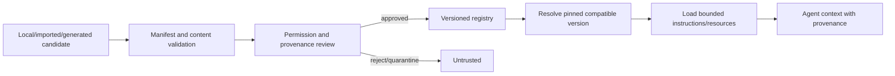

# Skill Engine

Skills package approved instructions and resources with metadata and declared tool capabilities. The engine resolves immutable versions, validates compatibility and permissions, applies trust labels, then loads bounded content into context. A skill does not grant permissions; the runtime policy and caller principal remain authoritative.

Manifest schema and `SKILL.md` convention are specified in [skill manifest](../specifications/skill-manifest.md). Executable code is not permitted by default. AI-generated skill candidates require human review; learning never escalates privileges or publishes automatically. See [skill security](../security/skill-security.md).
