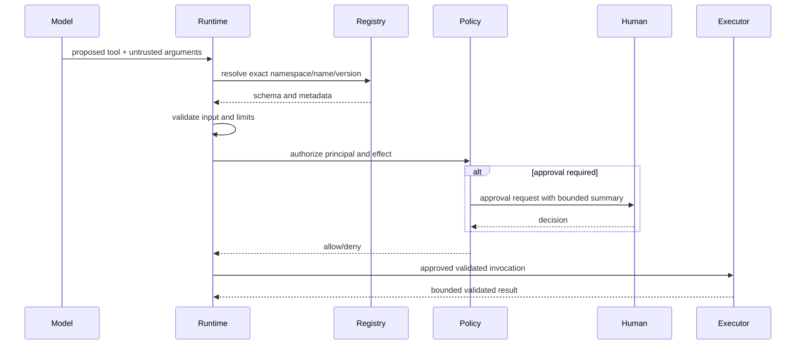

# Tool Engine

The tool engine registers typed capabilities, publishes schemas to compatible models, and executes only after independent policy evaluation. Arguments are untrusted even when schema-valid.

Registry metadata includes namespace, stable name/version, JSON Schema input/output, sync/async adapter, permission requirements, side-effect class, timeout and output limits, idempotency semantics, and dependencies. V03 supports trusted in-process handlers and an opt-in fixed-handler subprocess boundary using versioned bounded JSON. Subprocess handler IDs are statically allowlisted; neither model calls nor tool metadata select executable paths or modules. V04 ensures a standalone public `ToolExecutor` has no dispatch verifier and fails closed; the engine wraps a supplied executor's registry and configured boundaries in its engine-bound internal executor. Cancellation terminates and reaps the direct child, including cancellation during startup. This does not provide OS sandboxing or descendant cleanup. Sync in-process handlers run off the event loop, but cannot be forcibly stopped once started. Discovery exposes only authorized tools. Tool exceptions are normalized without leaking secrets or stack traces to the model. See [tool contract](../specifications/tool-contract.md) and [secure tool runtime](../security/secure-tool-runtime.md).
