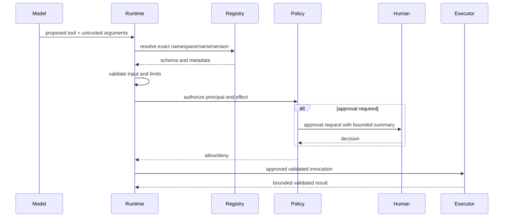

# Tool Engine

The tool engine registers typed capabilities, publishes schemas to compatible models, and executes only after independent policy evaluation. Arguments are untrusted even when schema-valid.

Registry metadata includes namespace, stable name/version, JSON Schema input/output, sync/async adapter, permission requirements, side-effect class, timeout and output limits, idempotency semantics, and dependencies. Sync tools must run off the event loop or be rejected by policy; blocking work cannot stall runtime cancellation. Discovery exposes only authorized tools. Tool exceptions are normalized without leaking secrets or stack traces to the model. See [tool contract](../specifications/tool-contract.md).
