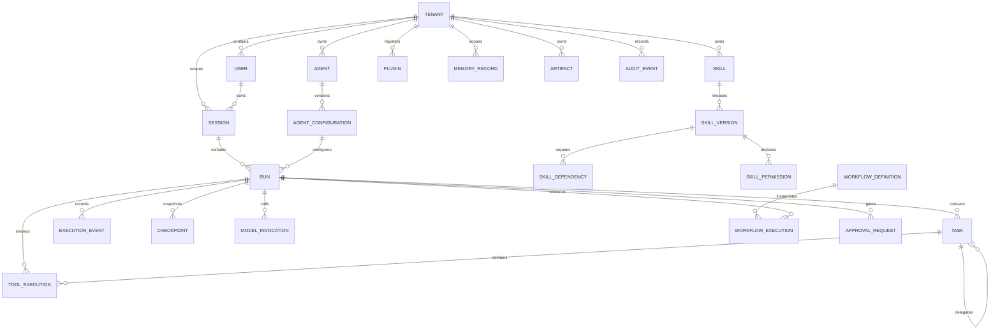

# Entity Relationships

Diagram omits scalar fields and optional ownership edges for readability. Every reference and optionality must be reflected in migrations and API validation. Use cascade deletion only where retention/legal policy permits; otherwise retain tombstones or anonymize with audited workflows. No raw credentials are modeled.
