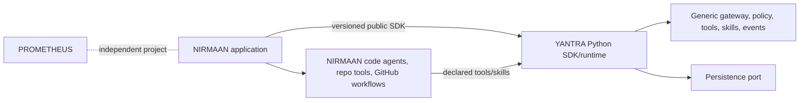

# NIRMAAN Integration Boundary

NIRMAAN is a separate autonomous software engineering application and downstream consumer. It must use a versioned public YANTRA SDK; YANTRA must not import, depend on, or contain NIRMAAN-specific business logic. No circular dependency is permitted.

YANTRA provides generic agent runtime, model gateway, tool and skill engines, memory/context interfaces, orchestration, execution policy, persistence ports, and observability. NIRMAAN owns repository analysis, code modification, test execution, software-engineering agents, repository-specific skills, GitHub workflows, engineering verification, and user-facing product behavior.

Integration is via SDK contracts/events, with application-owned tools/skills registered through supported APIs. NIRMAAN owns repository credentials and passes scoped references/capabilities; YANTRA does not assume GitHub or filesystem authority. SDK compatibility is tested against a consumer fixture before breaking changes. PROMETHEUS is also separate and is not a dependency.

Acceptance: independent builds, no import/dependency cycle, public API consumer test, clear ownership of tool permissions and data. Integration is proposed, not implemented.
