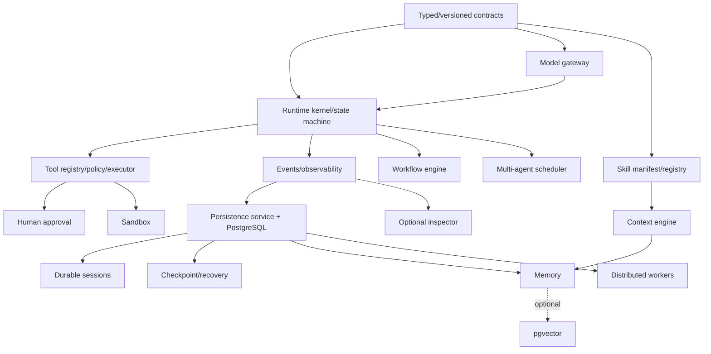

# Feature Dependencies

Core ordering: contract/versioning -> runtime/gateway/tool policy -> events -> durable service -> recovery -> skills/sandbox -> workflows/multi-agent/memory -> optional platform. Browser requires network policy and isolated worker. pgvector is optional and cannot block keyword memory. Inspector depends on APIs but no runtime component depends on it. NIRMAAN consumes public SDK only.
