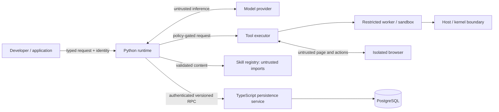

# Threat Model

**Status:** Design analysis, not a security certification. No implementation or penetration test is present.

## Assets and trust boundaries

Assets include user/tenant data, provider and integration credentials, host resources, tool effects, session/memory content, skill integrity, audit evidence, and database availability. Boundaries separate developer/application, Python runtime, model provider, tool executor, skill registry, browser, persistence service, PostgreSQL, sandbox/worker, and host.

## Threats and controls

| Threat | Impact | Required controls / residual concern |
|---|---|---|
| Prompt injection in user, skill, page, tool output | Unauthorized disclosure/action | Provenance/trust labels, separate policy, least privilege, output filtering, approval; model behavior cannot be guaranteed |
| Malicious tool output | Context manipulation, secret exfiltration | Treat as untrusted data, bound output, no instruction promotion, scoped secrets |
| Untrusted skill/plugin/dependency | Code execution or capability abuse | Quarantine, digest/provenance, review, no skill code by default, isolated plugin workers, dependency scanning |
| Unauthorized tool/model-generated shell | Host compromise or external effects | Independent authorization, executable allowlist, no raw shell, approval, isolation |
| Secrets exposure | Account compromise | Secret manager references, minimal injection, redaction tests, rotation, no DB/log storage |
| Sandbox escape/arbitrary code | Host/tenant compromise | Defense in depth, no privileged containers/control socket, OS/VM isolation where needed, patching; residual kernel risk |
| SSRF/browser abuse | Internal service access | URL canonicalization, DNS/IP checks at connection, redirect revalidation, egress firewall, domain policy |
| Data exfiltration | Confidentiality loss | Context minimization, provider allowlist, network egress policy, DLP/redaction, approvals |
| Cross-tenant access | Data exposure | Auth-derived tenant scope, query-level filters, RLS considered, negative isolation tests |
| Persistence service compromise | Bulk data access/tampering | mTLS/workload auth, scoped roles, audit, rate limits, DB least privilege, backup isolation |
| Malicious dependency/supply chain | Runtime compromise | Lockfiles, provenance, scanning, pinned builds, review and release attestations when available |
| Replay/race/worker duplication | Duplicate effects or state corruption | Idempotency where supported, CAS versions, fencing tokens, ambiguous outcomes, no exactly-once claim |

## Security principles

Default-deny capabilities; authenticated identity is out-of-band from model content; no raw credentials in database; explicit data classification and retention; all external content untrusted; tool authorization is central and non-bypassable; logs are redacted; failures fail closed for privileged effects. Docker is a packaging/isolation aid, not by itself a complete security boundary. Threat assumptions, supported environments, and residual risks must be reviewed before production claims.
